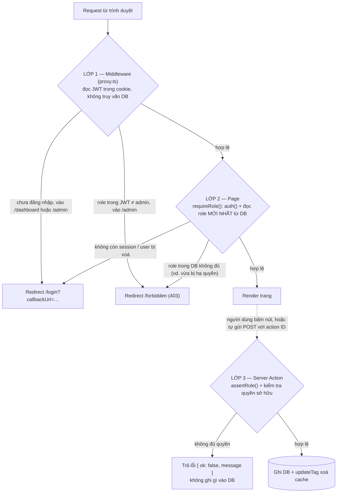

# Báo cáo bài tập tuần 8 — NextAuth, phân quyền & SEO

**Sinh viên thực hiện:** B23DCCC127  
**Dự án:** LTWNC Blog, một blog nhỏ có đăng nhập, phân quyền admin/user và SEO cho trang công khai.  
**Công nghệ:** Next.js 16.4 (App Router, Cache Components) · Auth.js v5 (NextAuth) · Prisma 6 + SQLite · Tailwind CSS v4 · TypeScript strict.

## 1. Đối chiếu yêu cầu đề bài

| Yêu cầu | Cách làm | File chính |
|---|---|---|
| NextAuth, ít nhất 1 OAuth provider | GitHub OAuth (`next-auth/providers/github`), tài khoản lưu bằng `@auth/prisma-adapter` | [auth.ts](auth.ts) |
| Đăng nhập email/mật khẩu | Credentials provider, mật khẩu băm bcrypt (cost 12), kiểm tra đầu vào bằng zod, có trang đăng ký | [auth.ts](auth.ts), [actions/auth.ts](actions/auth.ts) |
| 2 vai trò admin, user | Cột `User.role`, kiểu `Role = "admin" \| "user"` | [prisma/schema.prisma](prisma/schema.prisma), [lib/roles.ts](lib/roles.ts) |
| Phân quyền bằng Middleware | `proxy.ts` (Next.js 16 đổi tên `middleware.ts` thành `proxy.ts`, chức năng giữ nguyên, lúc build hiện `ƒ Proxy (Middleware)`) | [proxy.ts](proxy.ts) |
| Kiểm tra ở page | `requireRole()` trong `/dashboard` và `/admin` | [lib/dal.ts](lib/dal.ts), [app/admin/page.tsx](app/admin/page.tsx) |
| Kiểm tra ở Server Action | `assertRole()` ở đầu mọi action (`createPost`, `deletePost`, `updateUserRole`) | [actions/posts.ts](actions/posts.ts), [actions/admin.ts](actions/admin.ts) |
| Kiểu TypeScript đầy đủ cho Session | Mở rộng `Session`, `User` (module `next-auth`) và `JWT` (module `@auth/core/jwt`) | [types/next-auth.d.ts](types/next-auth.d.ts) |
| SEO cho ≥ 2 trang công khai | Trang chủ `/` và trang bài viết `/posts/[slug]` (thêm `/about`) | xem mục 3 |
| canonical | `alternates.canonical` trên từng trang, ghép với `metadataBase` | [app/page.tsx](app/page.tsx), [app/posts/[slug]/page.tsx](app/posts/[slug]/page.tsx) |
| opengraph-image | `app/opengraph-image.tsx` cho trang chủ, `app/posts/[slug]/opengraph-image.tsx` sinh ảnh riêng cho từng bài | [lib/og-image.tsx](lib/og-image.tsx) |
| JSON-LD | Trang chủ: `WebSite` + `Blog`. Bài viết: `BlogPosting` + `BreadcrumbList` (kiểu từ `schema-dts`) | [components/JsonLd.tsx](components/JsonLd.tsx) |
| Báo cáo: sơ đồ lớp bảo vệ + Lighthouse | Mục 2 và mục 4 của file này | — |

## 2. Sơ đồ các lớp bảo vệ

Mỗi lớp tồn tại vì một lý do riêng:

| Lớp | Kiểm tra gì | Vì sao chưa đủ nếu chỉ có lớp này |
|---|---|---|
| **1. Middleware** ([proxy.ts](proxy.ts)) | Có đăng nhập không, role trong JWT có đủ không. Chạy trước mọi request vào `/admin`, `/dashboard`, `/login`, `/register` | Chỉ đọc JWT, mà JWT không được cập nhật khi admin đổi role của ai đó. Server Action là request POST, không nhất thiết đi qua matcher của proxy. Tài liệu Next.js cũng nói proxy chỉ là "optimistic check" |
| **2. Page** ([lib/dal.ts](lib/dal.ts) `requireRole`) | Lấy user và role thật từ DB ngay trong page | Chỉ bảo vệ việc *xem* trang, không bảo vệ các *hành động* gửi lên server |
| **3. Server Action** ([lib/dal.ts](lib/dal.ts) `assertRole`) | Đầu mỗi action: đã đăng nhập chưa, role có đủ không, có phải chủ bài viết không | Đây là lớp cuối cùng, cũng là nơi duy nhất chặn được người gọi thẳng endpoint của action mà không qua giao diện |

Các biện pháp phụ:
- **Vai trò khi đăng ký luôn là `user`.** Server không đọc role từ form, chỉ admin mới nâng quyền được.
- **Admin không tự đổi role của chính mình**, để hệ thống không rơi vào cảnh không còn admin nào.
- **Chống open redirect:** `callbackUrl` chỉ nhận đường dẫn nội bộ (`/…`, không nhận `//…`). Xem `safeCallbackUrl` trong [lib/routes.ts](lib/routes.ts).
- **Thông báo lỗi đăng nhập không phân biệt sai email hay sai mật khẩu**, để không lộ email nào đã đăng ký.
- **JSON-LD:** thay ký tự `<` bằng `<` để chống XSS khi tiêu đề bài viết chứa `</script>`.
- **Ẩn link "Quản trị" với user chỉ là trải nghiệm**, không phải biện pháp bảo mật. Bảo mật nằm ở 3 lớp trên.
- `robots.txt` chặn `/admin`, `/dashboard`, `/api/`, còn các trang riêng tư có `noindex`. Cả hai chỉ phục vụ SEO, không thay thế xác thực.

### Kết quả kiểm thử phân quyền

Kiểm thử bằng trình duyệt thật (puppeteer) trên bản build production. Ảnh chụp ở `reports/screenshots/`.

| Tình huống | Lớp chặn | Kết quả | Ảnh |
|---|---|---|---|
| Khách vào `/admin` | 1 | Redirect `/login?callbackUrl=%2Fadmin` | `02-guest-admin-redirect-login.png` |
| Đăng nhập sai mật khẩu | — | "Email hoặc mật khẩu không đúng." | `03-login-wrong-password.png` |
| Bấm "Đăng nhập với GitHub" | — | Chuyển sang trang OAuth của GitHub với đúng `client_id`, có PKCE | `04-github-oauth.png` |
| User vào `/admin` | 1 (+2) | Redirect `/forbidden` | `07-user-admin-forbidden.png` |
| User xoá bài của admin (nút demo cố tình không ẩn) | 3 | "Bạn không có quyền xoá bài của người khác." | `06-user-server-action-denied.png` |
| User gọi action admin `updateUserRole` | 3 | "Bạn không có quyền thực hiện thao tác này." | `06-user-server-action-denied.png` |
| User gọi thẳng action bằng `curl` (header `Next-Action`, bỏ qua giao diện) | 3 | Server trả `{"ok":false,"message":"Bạn không có quyền thực hiện thao tác này."}` | — |
| User vừa bị **hạ quyền** admin → user, JWT vẫn ghi `admin`, vào `/admin` | 2 | Middleware cho qua (vì JWT ghi `admin`), nhưng page đọc DB nên trả `NEXT_REDIRECT → /forbidden`. HTML không chứa dữ liệu admin nào | — |
| Admin vào `/admin` | — | Thấy bảng người dùng, đổi được role, xoá được mọi bài | `08-admin-panel.png` |

## 3. SEO đã làm

| Hạng mục | Trang chủ `/` | Bài viết `/posts/[slug]` |
|---|---|---|
| `<title>` | `LTWNC Blog — Next.js, Auth.js và SEO` | `<tiêu đề bài> \| LTWNC Blog` (dùng template) |
| `meta description` | Mô tả site | Tóm tắt của bài (`generateMetadata`) |
| `canonical` | `http://localhost:3000` | `http://localhost:3000/posts/<slug>` |
| Open Graph / Twitter | `og:type=website`, `og:url`, `summary_large_image` | `og:type=article`, `article:published_time`, tác giả |
| `opengraph-image` | Ảnh 1200×630 sinh bằng `ImageResponse` | Ảnh riêng từng bài (tiêu đề, tóm tắt, tác giả). Font Inter nạp kèm subset tiếng Việt nên không vỡ dấu |
| JSON-LD | `WebSite` + `Blog` (kèm danh sách `BlogPosting`) | `BlogPosting` + `BreadcrumbList` |

Phần dùng chung cho toàn site:
- `lang="vi"` (bản cũ để `en`).
- `metadataBase` lấy từ `NEXT_PUBLIC_SITE_URL`.
- [app/sitemap.ts](app/sitemap.ts) và [app/robots.ts](app/robots.ts).
- `noindex` cho `/login`, `/register`, `/dashboard`, `/admin`, `/forbidden`.

Hiệu năng:
- Trang công khai được **prerender thành HTML tĩnh**: dữ liệu dùng `"use cache"` + `cacheTag`, menu người dùng đặt trong `<Suspense>`.
- Đăng hoặc xoá bài thì gọi `updateTag("posts")` để xoá cache ngay.
- Bật `experimental.inlineCss` để CSS Tailwind nằm thẳng trong `<head>`, bỏ một request CSS chặn render.

Ảnh OG của một bài viết: `reports/og/post-og.png`.

## 4. Điểm Lighthouse trước và sau

**Cách đo:**
- Lighthouse 13.5 (CLI) chạy trên bản build production (`next build && next start`) ở `localhost:3000`, Chrome headless.
- Đo 2 trang công khai. Mỗi trang đo chế độ **Mobile** (mặc định, giống PageSpeed Insights: Moto G Power, mạng 4G chậm giả lập) và **Desktop**.
- **Trước** = app đã có đăng nhập và phân quyền nhưng chưa làm SEO: chỉ có `<title>`, `lang="en"`, chưa có description, canonical, OG hay JSON-LD.
- **Sau** = bản nộp.

### Mobile

| Trang | | Performance | Accessibility | Best Practices | **SEO** | FCP | LCP | TBT | CLS |
|---|---|---|---|---|---|---|---|---|---|
| `/` | Trước | 95 | 100 | 100 | **90** | 1,4 s | 2,8 s | 80 ms | 0 |
| `/` | Sau | 96 | 100 | 100 | **100** | 1,3 s | 2,8 s | 40 ms | 0 |
| `/posts/xac-thuc-…` | Trước | 96 | 100 | 100 | **90** | 1,4 s | 2,7 s | 70 ms | 0 |
| `/posts/xac-thuc-…` | Sau | 96 | 100 | 100 | **100** | 1,2 s | 2,7 s | 40 ms | 0 |

### Desktop

| Trang | | Performance | Accessibility | Best Practices | **SEO** |
|---|---|---|---|---|---|
| `/` | Trước → Sau | 100 → 100 | 100 → 100 | 100 → 100 | **90 → 100** |
| `/posts/xac-thuc-…` | Trước → Sau | 100 → 100 | 100 → 100 | 100 → 100 | **90 → 100** |

**Nhận xét:**
- **SEO tăng từ 90 lên 100 trên cả 2 trang.** Bản "trước" trượt audit *"Document does not have a meta description"*. Bản "sau" qua hết audit SEO. Canonical, OG và JSON-LD không được Lighthouse tính điểm, nhưng đã kiểm tra trong HTML: JSON-LD parse hợp lệ, `og:image` trả về `image/png`.
- **Performance gần như không đổi**, vì bản "trước" đã prerender tĩnh nên nền đã cao. Thay đổi đo được trên mobile: FCP giảm 0,1–0,2 s nhờ chèn CSS thẳng vào HTML, TBT giảm từ 70–80 ms xuống 40 ms.
- **LCP mobile vẫn ~2,7–2,8 s**, hơi trên ngưỡng "tốt" 2,5 s. Đây là số mô phỏng của Lighthouse trên mạng 4G chậm. Lighthouse ghi nhận thời gian thật đến byte đầu tiên chỉ ~5 ms và độ trễ vẽ phần tử ~133 ms. Phần tử LCP là đoạn văn giới thiệu ở trang chủ.
- **PageSpeed Insights:** chỉ đo được URL public. Muốn có số PageSpeed thì deploy (ví dụ Vercel) rồi chạy lại. Lighthouse local dùng cùng engine, nên số không khác nhiều trừ phần thời gian mạng.

Báo cáo gốc mở được bằng trình duyệt: `reports/lighthouse/{before,after}-{home,post}-{mobile,desktop}.report.html`.

## 5. Cách chạy

Xem [README.md](README.md). Tài khoản mẫu: `admin@example.com / Admin@123` (admin) và `user@example.com / User@1234` (user).
